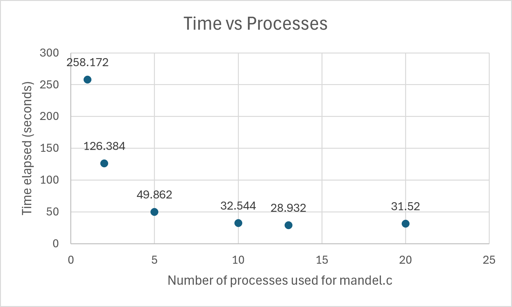

# Lab 11: Multiprocessing Mandelbrot Generator

**Author:** Joseph Hernandez  
**Course:** CPE 2600-111 
**Assignment:** Lab 11 - Multiprocessing  

## Overview

Uses Mandelbrot code to accept command line arguments and zoom in on the mandelbrot fractal using the calculations in mandel.c and on the git page.

Key implementation details:
* **Command-Line Parsing (`getopt`):** Extended `getopt` with `-p <number>` to set the maximum number of processes (1 to 50) and `-e <scale>` to set the ending zoom scale 

* **Process Management (`fork` / `wait`):** In `run_movie()`, the parent process tracks `active_children` and `next_frame`. It forks new child processes until either the chosen aomunt of processes is reached or all 50 frames have been launched. Whenever the limit is reached, the parent waits for the child to finish and creates another assigning each child a fram
* **Color Mapping:** `iteration_to_color()` uses RGB polynomial gradient to color the Mandelbrot pattern

## Plot



* Shows 
* P(1) = 258.172 s
* P(2) = 126.384 s
* P(5) = 49.862 s
* P(10) = 32.544 s
* P(13) = 28.932 s
* P(20) = 31.52 s

* The graph demonstrates the increasing efficiency of using more processors for complex calculations. Depending on the amount of processors in the device running the program it gets more efficient at different points. Since there are only 14 processors in the laptop the plot was made from, the system is fastest around that amount of processes. Depending on the device, the runtime will always be fastest around the max processors without going over that amount. After passing the amount of physical processors the speed will instead go back up as the processes fight for priority.

### Prerequisites
```bash
sudo apt update
sudo apt install libjpeg-dev ffmpeg


